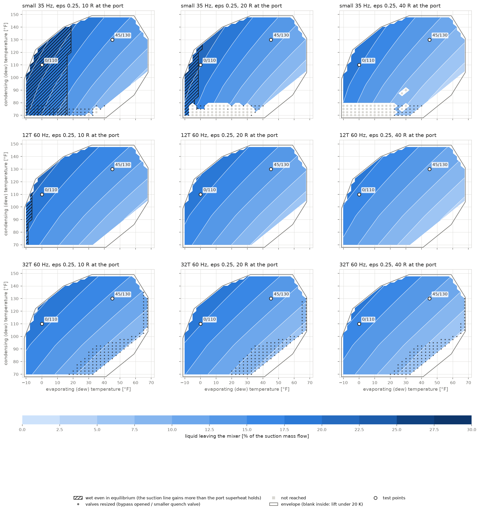
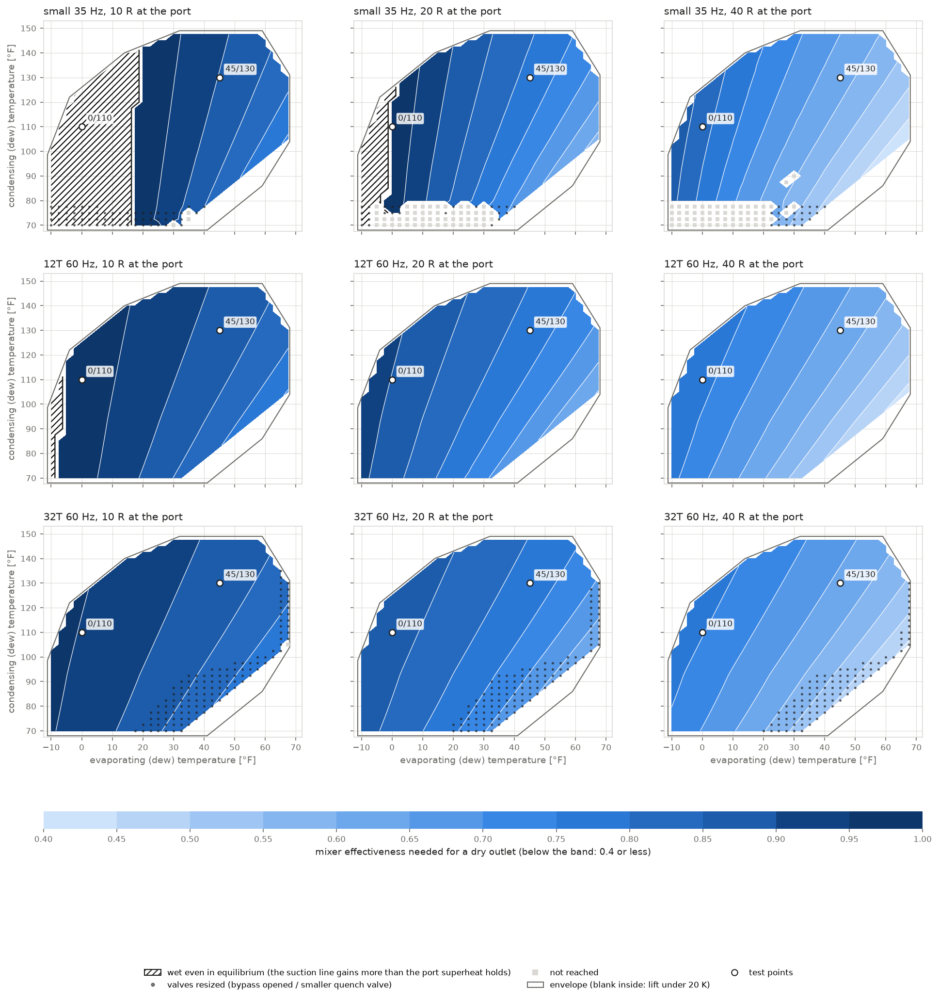

# Liquid leaving a poor quench mixer across the envelope

A planning map for the suction exchanger (the series brazed plate exchanger studied on the
`suction-bphe` branch). The older stands mix the hot gas bypass and the liquid quench in a
vessel that, at small flows and low return gas temperatures, transfers only part of the
heat it could, so quench liquid leaves with the gas out of equilibrium.

The question here is where in the compressor's envelope that happens, and how good a mixer
would have to be to prevent it. Two maps answer it:

* **liquid leaving a mixer of fixed effectiveness** (ε = 0.25, intentionally poor);
* **the effectiveness a mixer needs for a dry outlet**, which depends only on the operating
  point, not on an assumed mixer.

Script: [`examples/mixer_liquid_map.py`](../examples/mixer_liquid_map.py).

## Method

**The stand sets the flows.** At each evaporating / condensing point the whole stand is
brought to its steady state with the stand definition file
(`webui/config/stand_defaults.json`): superheat held at the compressor port, liquid at
30 °C (kept 4 K under condensing and 6 K over the cooling water), 25 °C ambient. That gives
what the controller sets at the mixer:
* hot gas $`\dot m_2`$ at $`h_{2}`$;
* quench $`\dot m_3`$ at $`h_{3}`$;
* the mixer pressure, and the suction line's heat gain downstream.

The split between the two streams comes from the stand's energy balance, so it does not
depend on what happens inside the mixer.

**The mixer.** The boiling quench has no temperature glide, so the hot gas is the minimum
capacity rate. A mixer of effectiveness ε transfers

```math
\dot Q = \varepsilon\, \dot m_2 \left( h_2 - h_v \right)
```

($`h_v`$: saturated vapor at the mixer pressure), and the quench liquid that heat does not
evaporate leaves with the gas:

```math
y = \frac{\max\!\left(0,\; \dot m_3 (1 - x_3) - \dot Q / h_{lv}\right)}{\dot m_2 + \dot m_3}
  = \max\!\left(0,\; y_\mathrm{eq} + (1 - \varepsilon)\, \frac{\dot m_2 (h_2 - h_v)}{(\dot m_2 + \dot m_3)\, h_{lv}}\right)
```

* $`x_3`$: the quench's flash quality at the mixer pressure.
* $`y_\mathrm{eq}`$: the liquid share of the mixed stream in equilibrium. Where it is positive,
  the suction line after the mixer gains more heat than the port superheat holds, and no
  mixer or exchanger dries the stream (hatched on the maps).

Elsewhere the effectiveness that just dries the stream is

```math
\varepsilon_\mathrm{req} = \frac{\dot m_3 (1 - x_3)\, h_{lv}}{\dot m_2 (h_2 - h_v)}
```

With the port superheat controlled, the hot gas's superheat is only a little more than the
quench liquid needs. The difference is the port superheat less the line's gain. So
$`\varepsilon_\mathrm{req}`$ is close to 1 at low superheat, and any shortfall leaves as
liquid.

## Cases

| machine | swept volume | speed |
|---|---|---|
| small, 35 Hz | 105 cm³/rev | 2071 rpm |
| 12T, 60 Hz | 168 cm³/rev | 3500 rpm |
| 32T, 60 Hz | 355 cm³/rev | 3550 rpm |

The superheat at the port is 10, 20 and 40 °F, on a 2.5 °F grid inside the R410A envelope
(`scenarios.R410A_ENVELOPE`). Points under the stand's 20 K minimum lift are left out.

```
python examples/mixer_liquid_map.py --SH-R 10 20 40            # about 3 minutes
```

## How each point is reached

| stage | what | points |
|---|---|---|
| 1 | the steady-state solver, stand as defined | 6107 |
| 2 | the solver with the mixing exchanger's evaporating coefficient `mx_alpha_e` / 3 | 510 |
| 3 | valves pinned wide open get 3× their Kv (manual bypass or larger valve) | 329 |
| 4 | the stand's PID loops settle it from the solver's best state, the quench valve at 0.3× its Kv where it runs under 5 % open | 112 |
| | **reached** | **7058 of 7173** |

**Stage 2 is a solver aid.** At small flows the stand's own mixing exchanger (sized for the
large machines) holds a liquid pool. The solver does not bring that pool's profile to rest,
and under the PID loops the pool's slow dynamics also drive the quench loop unstable. That
exchanger only passes the stand's flows to the mixer studied here. Where both solves
converge, the flows agree within 0.3 % and the mapped liquid within 0.05 points.

**Stages 3 and 4 resize valves.** Valves throttle at constant enthalpy, so a resized valve
changes whether the stand can hold a point, not its thermodynamics. Dots on the maps mark
the 441 points that needed resized valves:
* the 32T machine at low lift, with valve 1 and sometimes the water valve wide open;
* the small machine, with the quench valve nearly shut.

The CSV records how each point was reached (`method`) and the factors applied.

| reached, of 797 per panel | 10 °F | 20 °F | 40 °F |
|---|---|---|---|
| small, 35 Hz | 794 | 744 | 739 |
| 12T, 60 Hz | 797 | 797 | 797 |
| 32T, 60 Hz | 796 | 797 | 797 |

**The remaining gap** is the small machine below about 78 °F condensing, at 20 and 40 °F
superheat. There the liquid reaches the quench valve with almost no subcooling (the
receiver sits 4 K under condensing), it flashes in the valve, and neither the solver nor
the PID loops bring the receiver pool to rest.

## Results





| machine | superheat | ε needed, range | at 0/110 | at 45/130 | liquid leaving at ε = 0.25 | wet in equilibrium |
|---|---|---|---|---|---|---|
| small, 35 Hz | 10 °F | 0.74–1.00 | (wet) | 0.90 | 7–24 % | evaporating ≤ 17.5 °F |
| | 20 °F | 0.58–1.00 | 0.99 | 0.78 | 6–23 % | evaporating ≤ 0 °F |
| | 40 °F | 0.41–0.89 | 0.82 | 0.62 | 4–20 % | none |
| 12T, 60 Hz | 10 °F | 0.75–1.00 | 0.98 | 0.88 | 7–21 % | evaporating ≤ −7.5 °F |
| | 20 °F | 0.60–0.93 | 0.90 | 0.78 | 6–20 % | none |
| | 40 °F | 0.43–0.80 | 0.77 | 0.63 | 5–19 % | none |
| 32T, 60 Hz | 10 °F | 0.75–0.97 | 0.95 | 0.88 | 7–20 % | none |
| | 20 °F | 0.60–0.89 | 0.87 | 0.78 | 6–20 % | none |
| | 40 °F | 0.44–0.78 | 0.75 | 0.64 | 5–18 % | none |

**Findings:**

1. **A poor mixer passes liquid everywhere.** At ε = 0.25, 4–24 % of the suction flow leaves
   it as liquid. That is most of the quench liquid: 10–30 % enters it as liquid. It is
   worst at low evaporating and high condensing temperatures, where the hot gas is hottest
   and the quench share largest.
2. **The needed effectiveness is high at low superheat.** It is 0.75–1.0 at 10 °F at the
   port, and close to 1 along the low-evaporating edge. Each step to warmer return gas lowers
   it: about 0.1 to 20 °F, about 0.25 to 40 °F. This fits the field experience that the
   old mixer works at warm return gas temperatures.
3. **The machine matters little, except through the suction line.** The contours of the
   three machines nearly coincide, because the split between hot gas and quench comes from
   the energy balance (lift and discharge temperature), not from the displacement. The
   machine enters through the suction line's heat gain per kg. At the small machine and
   10 °F that gain exceeds the port superheat up to 17.5 °F evaporating (hatched), and it
   adds about 0.05–0.12 to the needed effectiveness at low evaporating temperatures.

## Using the maps for planning

A fixed effectiveness cannot reproduce "the old mixer works on the larger machines". A real
mixer's effectiveness rises with flow (gas velocity in the coil, more of the liquid
reaching it).

The ε-needed map avoids assuming one. Estimate the old mixer's actual effectiveness for
each machine from field cases where it does and does not pass liquid: a measured energy
balance at a point near the edge of trouble pins it down. Where the map's needed
effectiveness exceeds that value, the suction exchanger is needed.

The hatched regions need more than any mixer can give. There the remedy is a better
insulated suction line, or superheat control ahead of the line.

## Limitations

* **Steady states only.** Carry-over during speed and setpoint changes is not mapped.
* **Mixer ambient losses** are left out (the vessel's shell); they slightly favour a dry outlet.
* **Stand data.** The suction line's heat gain and the liquid temperature are the stand
  file's (`UA_sa` 12 W/K; liquid at 30 °C). Colder liquid flashes less in the quench valve
  and leaves more liquid; `--T-int` and `--set UA_sa=...` change them.
