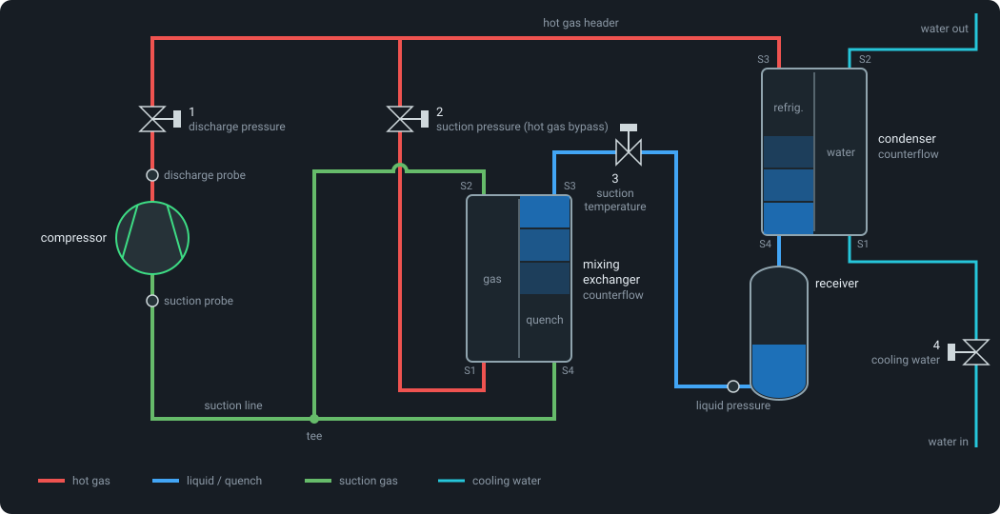

# The stand model

What the simulator represents and how. Pressure drops and the charge have their own
pages: [pressure-drop.md](pressure-drop.md), [charge.md](charge.md).

## Hardware



* **Condenser and mixing exchanger:** both Alfa Laval ACH-70X-78M-F (drawing
  `3287083725`). 78 plates form 77 channels: 39 on S1-S2 and 38 on S3-S4, 0.095 L each
  (3.71 L and 3.61 L per side). Heating surface 6.588 m², net weight 16.19 kg.
  * The drawing says "6.588 ft²". That can only be m²: 0.18 kg per plate of 0.25 mm
    stainless steel is about 0.087 m² per plate, and 76 × 0.087 = 6.6 m².
  * S3-S4 (with the 7/8 in N60 distributor at S3) carries the refrigerant in the condenser
    and the quench in the mixing exchanger; S1-S2 carries the water and the bypass gas.
* **Receiver:** Standard Refrigeration UR66 (MP), about 26.5 L inside (its pumpdown rating
  of 61 lb R22 at 90 % full, 90 °F). The outlet is a dip tube whose inlet sits at
  `rec_dip` (4 %) of the volume.
* **Compressor:** 5 L internal suction volume behind the suction port and probe; 1.5 L
  internal discharge volume (estimate). It draws in at most 30 % liquid by mass
  (`comp_x_min` = 0.7); more liquid collects in its shell.
* **Piping:** copper, ACR type L. Each line is `D_*` (outside diameter), `t_*` (wall),
  `L_*` (length) and `K_*` (fittings loss):

| line | size | length | volume |
|---|---|---|---|
| discharge (compressor -> valve 1) | 1-1/8 in | 4 m | 2.13 L |
| hot gas header (valve 1 -> condenser, valve 2) | 1-1/8 in | 4 m | 2.13 L |
| bypass (valve 2 -> S1) | 1-1/8 in | 0.5 m (estimate) | 0.27 L |
| quench (valve 3 -> S3) | 7/8 in | 0.5 m (estimate) | 0.16 L |
| exchanger outlets (S2, S4 -> tee) | 1-3/8 in | 1 m (estimate) | 0.81 L |
| suction (tee -> compressor) | 1-5/8 in | 4 m | 4.59 L |
| condensate drain (condenser -> receiver) | 7/8 in | 0.5 m (estimate) | 0.16 L |
| liquid line (receiver -> valve 3) | 7/8 in | 3 m | 0.94 L |

These give the model's volumes (`hgbp_sim/geometry.py`, also on the web UI's Settings
tab):

| volume | contents | size |
|---|---|---|
| suction side | mixing exchanger, tee, suction line, compressor inside | 18.1 L |
| discharge | compressor inside, discharge line | 3.6 L |
| intermediate section | header, condenser, drain, receiver, liquid line | 33.3 L |

Heat capacities follow from the same data: condenser plates plus water content
23.6 kJ/K, exchanger plates 8.1 kJ/K (both split over their cells), suction and discharge line
copper 3.1 and 1.5 kJ/K, receiver shell 12 kJ/K (25 kg of steel, estimate).

## Model structure

Every volume $`V`$ with pressure $`P`$, enthalpy $`h`$, density $`\rho(P, h)`$ and mass
$`M = \rho V`$ has a mass and an energy balance:

```math
V \left( \frac{\partial \rho}{\partial P}\bigg|_h \frac{dP}{dt} + \frac{\partial \rho}{\partial h}\bigg|_P \frac{dh}{dt} \right)
  = \sum \dot m_\mathrm{in} - \sum \dot m_\mathrm{out}
```

```math
M \frac{dh}{dt} = \sum \dot m_\mathrm{in} \left( h_\mathrm{in} - h \right)
  - \sum \dot m_\mathrm{out} \left( h_\mathrm{out} - h \right) + \dot Q + V \frac{dP}{dt}
```

### Intermediate section: condensing zone and receiver pool
Two zones share the pressure `P_i`, which is measured after the receiver:

* **Condensing zone:** the header, the condenser, the drain line and the receiver's vapor
  space. It is one (P, h) volume in equilibrium. Besides vapor it holds the condenser's
  liquid:
  * the condensing film. This is Zivi's void fraction on the quality profile of the
    condenser cells (`M_film`, 0.45 kg at the rating point).
  * the condensate on its way down the drain. Liquid beyond the film drains to the receiver
    with the time constant `cond_tau_drain` (1 s).
* **Receiver pool:** the liquid in the receiver and the liquid line, with its own mass and
  temperature (states `M_L`, `h_L`). It takes the drain flow, feeds valve 3 and exchanges
  heat and mass with the vapor:
  * After a pressure rise the pool is subcooled. Vapor condenses on its surface only slowly
    (`rec_UA_lv`, 20 W/K), so the subcooling at valve 3 jumps and then relaxes over
    minutes.
  * After a pressure drop the pool is superheated and flashes with the time constant
    `rec_tau_flash` (1 s). The vapor holds the pressure up, the pool cools to saturation,
    and valve 3 receives flash gas (no subcooling) until it has.

Where the liquid sits:

* **The pool fills, in order,** the receiver up to the dip tube inlet, the liquid line,
  then the rest of the receiver. The sight glass reading is `rec_level`.
* **Below the dip tube,** vapor from the receiver enters the liquid line and valve 3 loses
  its liquid seal (flag `no_liquid_seal`).
* **A full receiver** passes only what valve 3 takes. The drain backs up and liquid floods
  the condenser from the bottom (`cond_flood`), removing condensing area.
* **Subcooling.** The condensate subcools on its way down, over the wetted bottom of the
  plates (the share `cond_sc_film`, 9 %, or the flooded area), against the wall cells
  there. This sets the pool's temperature and so the subcooling at valve 3 (2.9 K at the
  rating point).
* **Receiver shell.** Its temperature exchanges heat with the pool (`rec_UA_r`, scaled
  with the level), the vapor (`rec_UA_rv`) and ambient.

### Condenser
The condenser has the same five-cell layout as the mixing exchanger, top (S3) to bottom
(S4). Each cell has its own plate wall temperature (plates plus water content). The
refrigerant belongs to the condensing zone, and the flow through it is quasi-steady:

* **Refrigerant side (S3 -> S4),** marched down the cells. Hot gas from the header enters
  at S3 and leaves the last cell above the liquid at the bubble point, so the flow is what
  the plates condense: $`\dot m (h_\mathrm{in} - h_l) = \sum \dot Q`$. In steady state it
  equals the quench flow.
  * A wall below the condensing temperature is wet. Vapor condenses on it (`alpha_r_2ph`,
    driven by the condensing temperature, which follows the glide of a blend), and
    superheated vapor gives up its superheat to the condensate (`alpha_r_1ph`, wet-wall
    desuperheating).
  * A wall above the condensing temperature stays dry and only exchanges sensible heat
    with the vapor. The two cases blend over 0.2 K.
  * Every cell reports its quality (`x_c`) and temperature.
* **Flooded cells:** liquid backing up from a full receiver fills the cells from the
  bottom. The condensate draining down through them subcools against their walls.
* **Water side (S1 -> S2, counterflow):** the water rises through the wall cells, with
  effectiveness-NTU per cell and `alpha_w0` scaling with flow^0.8.

At the rating point the hot gas enters at 77 °C, 49 K superheated. The top wall runs above
the saturation temperature (dry desuperheating), and the cells below condense.

**Compared with the mixing exchanger's quench side.** Both have five cells with their own
plate walls and a counterflow stream on the other side. The quench cells, however, are
dynamic finite volumes, while the condenser's refrigerant side is quasi-steady, like the
mixer's gas side:

| | quench side | condenser, refrigerant side |
|---|---|---|
| cell states | enthalpy per cell, integrated | none: the profile follows the walls at every evaluation |
| mass and energy | per cell, in the suction side's conserved group | the condensing zone, one equilibrium volume |
| liquid hold-up | per cell, counted in the charge | film (void fraction per cell) and draining condensate, in the condensing zone; counted in the charge |
| flow | valve 3 and the pressure solve (can reverse between cells) | what the plates condense |
| transport delay | yes (part of the valve 3 -> suction temperature response) | the drain lag (`cond_tau_drain`); otherwise the wall mass |
| pressure | each cell at its own pressure (static head, friction from the plate geometry) | all cells at `P_i`; lumped `cond_Kv_r` drop |
| regime change | dry-out share of the cell's area, blended over 15 kJ/kg | wet / dry wall, blended over 0.2 K |
| coefficients | scale with flow (`mx_alpha_e` ^0.5, `mx_alpha_v0` ^0.8) | constant (`alpha_r_2ph`, `alpha_r_1ph`); water side ^0.8 |
| steady-state solver | own inner solve (`march_mixer`, `newton_mixer`) | wall temperatures as outer unknowns |
| displayed per cell | the cell's state (= its outlet), at its outlet pressure | the state leaving the cell at its outlet pressure (the bottom cell: the subcooled drain); the model itself condenses at each cell's mean |

The liquid section's dynamics live in the receiver pool and in the condensing zone's hold-up.
The plates and their water (23.6 kJ/K) dominate the condenser's own thermal response.

**Possible improvements**, in increasing effort:
* **Condensing coefficient.** At the stand's mass fluxes (about 19 kg/(m2 s) in the
  channels), condensation in brazed plates is gravity-controlled (Longo et al. 2015): the
  coefficient does not depend on the flow but on the wall temperature difference,
  ΔT^-1/4 (Nusselt). Modelling this needs the liquid's thermal conductivity in the property
  tables.
* **Per-cell condensing pressure** from the column's static head and friction.
* **Receiver stratification:** a layered pool, with the dip tube drawing from the bottom.
* **Dynamic condenser cells:** enthalpy states with their own hold-up, in a common-pressure
  group with the receiver pool.

### Suction side
One common pressure `P_s`, taken at the compressor suction port. The cells are five
quench-side cells of the mixing exchanger (enthalpy states, top to bottom), each against
its own plate-wall temperature; the tee plus suction line; and the compressor's internal
suction volume, from which the compressor draws. Flows between cells follow from the
common pressure (lumped-pressure finite volumes).

The bypass gas side (residence time about 0.2 s) is quasi-steady: marched cell by cell
from S1 up to S2 against the same walls. Heat transfer per cell:
* **gas side:** `mx_alpha_g0` (500 W/m²K at 0.5 kg/s, scaling with flow^0.8);
* **quench, evaporating:** `mx_alpha_e` (1500 W/m²K at 0.13 kg/s, scaling with flow^0.5);
* **quench, vapor after dry-out:** `mx_alpha_v0` (250 W/m²K, scaling with flow^0.8);
* **dry-out cell:** the evaporating share of its area is what the incoming liquid needs;
  the rest heats vapor, so the vapor cannot leave hotter than the plate. The two cases
  blend over 15 kJ/kg above the dew point, so the dry-out point moves smoothly through
  the cells.

### Tee and suction probe
Liquid leaving S4 travels as droplets that evaporate with the time constant
`tee_tau_evap` (0.3 s) on the way along the suction line.
* The probe reads the vapor temperature, so it can read superheat while liquid still
  reaches the compressor.
* `y_liq` is the liquid mass share at the compressor port; floodback is flagged above
  `y_flood` (0.5 %).
* The bypass gas leaves pinched close to saturation whenever the quench side runs wet, so
  in practice the tee mixture turns wet together with the quench outlet.

### Compressor
Quasi-steady map: volumetric efficiency with clearance re-expansion,
$`\eta_v = \eta_{v0} - c_\mathrm{cl} \left( \Pi^{1/\kappa} - 1 \right)`$ with pressure ratio $`\Pi`$
(`eta_v0`, `c_cl`, `kappa`), isentropic efficiency as a parabola in
pressure ratio and speed, motor/VFD efficiency with a share of the motor loss heating the
suction gas, discharge gas to shell heat exchange, shell thermal mass and losses to
ambient, VFD speed ramp and lag. The discharge temperature therefore shows the slow
warm-up seen on real stands.

### Valves, actuators
* Valves 1 and 2: ISA-style compressible flow with choking. Valve 3: incompressible,
  flashing orifice. Valve 4: water valve.
* Every valve is sized by its `Kv` (m³/h of water at 1 bar), as the hardware is
  specified: $`\dot m = \frac{K_v}{36000} f(u) \sqrt{\rho \, \Delta P}`$, with a linear,
  equal-percentage or quick-opening characteristic $`f(u)`$.
* The condenser's water, in one of two arrangements (`w_loop`):
  * **Once through** (0, the default): valve 4 is in series with the condenser water side and
    the plant piping, driven by the plant loop's supply-to-return difference (1.5 barg /
    0.35 barg), and the condenser takes the supply.
  * **Run-around loop** (1, the stand's): a pump circulates `w_loop_mdot` through the
    condenser. The facility's supply enters at the pump's suction, and valve 4 (in series with
    the bleed piping, `Kv_wpipe`) passes the condenser's outlet water to the facility's return.
    The stand's chilled-water loop holds 20 psid between supply and return (`P_w_sup -
    P_w_ret`).
    * **The loop as a state:** one well-mixed volume of `w_loop_M` (pump, piping, condenser
      water side). The condenser's duty and the pump's heat (`w_pump_heat`) go in, and the
      bleed's excess over the supply goes out. The condenser takes the loop's mixed water,
      `T_wl`, and the stand's water inlet sensor, on the condenser's inlet, reads it
      (`measure()["T_wi"]`); `T_wi` as an input stays the facility's supply.
    * **The pump runs with the compressor** (`w_pump_auto` 1, the stand's). While it stands,
      valve 4's flow passes the condenser straight from the supply, the inlet sensor reads the
      supply, and the loop's other water stands where it was. At a start the pump mixes that
      water in: the stand's inlet reading jumps 6-13 K within about 10 s of every logged start.
    * **The time constant** is the loop's water over the bleed: about a minute at the stand's
      usual openings. Closing valve 4 heats the loop for minutes, and the liquid pressure
      follows. That lag is what the once-through arrangement left out.
    * **Fitted to the stand's logs (2026-10-19):** the inlet temperature against valve 4's
      position and the compressor power gives 36 kg of water (0.5 K RMS over 6 h). Valve 4 is
      the stand's Kv 12, equal percentage. The pump's flow, 7.7 kg/s (123 gpm), is where its
      curve (95 ft at shut-off, 65 ft at 150 gpm) meets the condenser's water side and some
      loop piping.
* **The stand definition's first calibration** (2026-10-20, the 45/130 °F point the stand held
  for hours: power, discharge temperature, volume flow, the water inlet and the four valve
  positions):
  * **Compressor:** `eta_s0` 0.637, `eta_v0` 0.977 and `eta_motor` 0.95. The stand's
    compressor is an older one with many hours on it.
  * **Condenser:** `alpha_w0` 278. This is effective: the stand runs about 10 K between the
    mixed water and the condensing temperature at 37 kW.
  * **Bleed piping:** `Kv_wpipe` 30.
  * **Valves** (all three are the same make; their datasheet's sizing tables):
    * **Valves 1 and 2:** the small parallel valves are out of service on the stand (`Kv_dpv2`,
      `Kv_spv2` 0). At nameplate Kv the model then runs them at 42 and 63 %, against the stand's 37
      and 58 %.
    * **Valve 3 chokes.** The datasheet's expansion capacities barely change with the pressure drop.
      Liquid arriving 2 K subcooled flashes in the valve and passes far less than Kv sqrt(rho dP)
      says.
      * **The law:** `stv_choke` 1 limits the effective drop to F_L^2 (P1 - F_F P_v), with P_v the
        liquid's vapor pressure.
      * **Fitted to the R410A table** (the datasheet's 2019 edition): F_L 0.593, F_F 0, so the drop
        is capped at 0.35 P1, at 6.1 % RMS. The constant 0.7 P1 cap was 35 % off.
      * **Other refrigerants:** the 2021 edition's R134a and R32 tables fit at F_L 1.416, F_F 0.882.
    * **The quench's position at 45/130:** at the nameplate Kv 1.0, the R410A law runs valve 3 at
      20.5 %, against the stand's 29 % (the kvs-reduction switches are confirmed at 100 %; the
      sight glass is clear).
      * **The editions disagree:** where they overlap (R134a, choked), the 2021 edition rates the
        same valve at about 0.83 of the 2019 one. That alone would put the valve near 25 %.
      * **The rest** is within the valve's ±3 % full-scale accuracy and 3 % hysteresis.
      * **The stand definition** takes valve 3's effective Kv from the stand: 0.707.
  * **Still off:** in a 45/130 → 59/150 transition, the model's suction gas heats about twice
    as fast as the stand's measured RGT.
* **The start, calibrated (2026-10-20)** against four logged starts: two under the stand's PID
  loops, and two restarts driven by a learned controller. The stand's valve commands were
  replayed open loop, compared over the first 10-180 s (open loop drifts later).
  * **The idle stand at a cold start:** the environment draws two things per cold start. Both
    default to 0, the earlier behaviour.
    * **The charge equalizes below ambient** (`EnvConfig.cold_eq_below`, `cold_start(eq_below=)`).
      The condenser's water holds the condenser, receiver and liquid line cooler than the room.
      The stand read 18-24.5 °C saturation with its suction line at 26-28 °C. The vapor on the
      suction and discharge sides is superheated to ambient, and their walls are at ambient.
    * **The loop's standing water** (`EnvConfig.cold_loop_share`, `cold_start(loop_share=)`) is
      a share of the way from the supply to ambient. The room warms it, or it is left from the
      last run. The starts fit at 0.35-0.55. With the loop at the supply, the model's start ran
      3-7 K low in SST and SDT, and its suction gas up to 18 K cool. A warm loop condenses
      less, the discharge and the bypass's hot gas run higher, and the suction heats.
  * **Discharge gas to the compressor shell:** `UA_gs` 100 W/K (from 40). The discharge
    temperature's first minutes match: about 1 K RMS on the slower PID start, against 6-12 K.
    The steady state hardly moves, since the shell settles near the gas.
  * **Checked:** the learned controller's two restarts trip at the suction temperature limit
    30-33 s after the start, where the stand's ended (41-43 °C at the stand's suction probe).
    The 45/130 → 59/150 high liquid pressure trip still comes at 100-129 s (the stand: 96 s).
  * **Still off:** on the slow PID start the stand's suction gas warms from 7 to 28 °C over
    3 min at near-constant valve positions, while the model's stays near 17-21 °C. Scaling valve
    3 does not fit both PID starts.
    * The stand's suction probe sits near the compressor's suction port, and it read 37-42 °C
      on the hot compressor before the restarts. Heat from the compressor's body into the
      probe or the gas there is one candidate.
* Actuators: first-order lag and slew-rate limit.

### Sensors and trips
* Pressure transducers (noise); temperatures at the compressor suction port, discharge and
  the liquid line at valve 3 (first-order lag + noise); mass flow and power meter (lag +
  relative noise); receiver sight glass. The stand measures flow with a
  positive-displacement meter in the suction line: `measure()` also gives that volume
  flow (`Vdot`), the mass flow reading at the vapor density of the measured suction
  pressure and temperature.
* Trips: high discharge pressure, high discharge temperature, low / high suction pressure,
  high suction gas temperature, high liquid pressure. The defaults are the stand's hard
  limits:
  * 700 psia (48.3 bar) on the discharge pressure;
  * 320 °F (160 °C) on the discharge temperature;
  * a 30 psia (2.07 bar) minimum suction pressure;
  * 104 °F (40 °C) at the suction-line flow meter's inlet (`T_s_max`: its aluminium lobes
    expand into the steel housing above it);
  * 350 psia (24.13 bar) on the liquid pressure (`P_i_max`).

  `HGBPPlant.HARD_TRIPS` lists them.
* Flags: liquid at the compressor (floodback), quench liquid leaving the mixing exchanger,
  no liquid seal (undercharge), receiver full and condenser flooding (overcharge).
* The liquid line sensor reads the receiver pool's temperature with its lag. While the pool
  flashes after a pressure drop it reads above the new saturation temperature: the
  displayed subcooling turns negative for a moment, as on a real stand.

### Refrigerant properties
CoolProp is far too slow inside the model, so properties come from bilinear interpolation
in tables aligned with the saturation dome (superheated and subcooled regions in
`(log P, zeta)` coordinates, two-phase analytic). Accuracy against CoolProp for R134a:
temperature < 0.04 K, density < 0.1 %. Tables for R410A (default), R454B, R454C and R134a
ship with the package; other CoolProp fluids are tabulated on first use. R454B and R454C
are CoolProp mixtures of R32 and R1234yf; their surface tension (not available from
CoolProp for mixtures) is the mole-fraction average of the components'.

## Numerics

* **Conserved states.** Mass and internal energy are integrated for:
  * the suction side, as one group;
  * the discharge volume;
  * the intermediate section, together with the receiver pool's mass and enthalpy.

  After every sub-step the states are projected back:
  * The discharge volume is flashed back from its density and energy.
  * The condensing zone is flashed from the section's mass and energy less the pool's, in
    the volume the pool leaves free.
  * For the suction side, the pressure and a uniform enthalpy shift of its cells are
    corrected by Newton iteration.

  The charge is conserved to machine precision.
* **Integrator.** RK4 at `dt = 0.05 s` with automatic sub-steps. The model estimates its
  fastest local rate (valve conductance over the capacitance of each pressure node, plus
  advection, heat transfer and dry-out switching in the quench cells, the condensate drain
  and a flashing receiver pool), and each step is
  split until rate × sub-step ≤ 1.8 (up to 32 sub-steps; nearly liquid-full volumes take
  at least 4). A sub-step that produces a non-finite state or an implausible jump is
  redone four times finer.
* **Compiled.** The model runs as compiled code (numba, `hgbp_sim/kernel/`): every stand
  of a batch integrates in its own loop iteration with its own sub-steps, and the batch
  runs in parallel on the CPU cores.

### Steady-state solver
`solve_steady_state` finds the valve positions and states at a test point, given the
charge (or a receiver level). One Newton problem over the whole stand is ill-conditioned,
because a generously sized counterflow exchanger's outlet state hardly depends on where
the quench dries out. The solver therefore alternates:
1. **The stand.** The equations are the overall mass and energy balances of the suction
   side and of the intermediate section, plus the rates of the other states. The unknowns
   are the valve positions, the discharge enthalpy and the wall temperatures
   (Levenberg-Marquardt). The receiver pool's enthalpy is brought to rest at every
   evaluation, by a Newton step on its energy balance.
2. **The receiver pool.** The condensing zone keeps the film's hold-up plus what is on its
   way down the drain, so the drain passes what valve 3 takes. The rest of the charge sits
   in the pool, up to a full receiver.
3. **The exchanger profile** for the resulting flows: pseudo-time stepping of its own cell
   and wall dynamics, then a Newton polish.

The rounds repeat until the liquid held on the suction side stops changing, typically
3-6 rounds and about 30 ms per stand.

With a full receiver, the pool's temperature sets its density and so how much liquid floods
the condenser, and the flooding feeds back on the pool's subcooling. If the first attempt
fails there, a second one solves for the pool's enthalpy together with the other unknowns.

## Behaviour at the rating point

R410A, 3550 rpm, 9.98 / 33.89 / 18.0 bar, suction probe at 18.33 °C (about 11 K
superheat), 10 °C water, nominal charge 14.2 kg:

| quantity | value |
|---|---|
| compressor / bypass / quench flow | 0.648 / 0.519 / 0.129 kg/s |
| mixing exchanger duty | 30 kW |
| quench quality, cells top -> bottom | 0.23, 0.46, 1.01, 1.15, 1.21 (dries out in the middle cell) |
| gas outlet S2 / quench outlet S4 | 11 °C / 50 °C, mixing to 18.3 °C at the tee |
| liquid held in the exchanger | 0.13 kg |
| condenser quality, cells top -> bottom | 1.22, 1.01, 0.79, 0.53, 0.19 (hot gas enters 49 K superheated) |
| liquid in the condenser | 0.58 kg (film 0.45 kg, draining 0.13 kg) |
| cooling water | 0.53 kg/s, 10 -> 24.3 °C (valve 4 at 49 %) |
| receiver level | 35 % (pool 10.9 kg at 25.2 °C) |
| subcooling at valve 3 | 3.0 K |

* A +10 % step on valve 3 lowers the suction temperature over about a minute: the plate
  mass dominates the response.
* At a 5 K superheat setpoint the same step wets the quench outlet after about 35 s, and
  floodback follows.
* Opening the water valve fully lowers `P_i` by several bar within a minute. The receiver
  pool is left superheated and flashes (up to about 50 g/s), and valve 3 loses its
  subcooling within 5 s.
* Closing the water valve to 30 % raises `P_i` faster than the pool follows. The subcooling
  at valve 3 grows to about 12 K, then relaxes over minutes as vapor condenses on the pool.

## Parameters

All parameters are fields of `PlantParams` (`hgbp_sim/params.py`), in SI units; the web
UI's Settings tab lists them with descriptions and units. Defaults describe the stand: a
variable-speed 355 cm³/rev semi-hermetic compressor on R410A.

| group | parameters |
|---|---|
| compressor | `V_disp`, `N_nom`, `eta_v0`, `c_cl`, `eta_s0`, `a_s`, `Pr_opt`, `eta_motor`, `f_motor_gas`, `C_shell`, `UA_gs`, `UA_sha`, `ramp_N`, `V_comp_suc`, `V_comp_dis`, `comp_x_min` |
| piping | `D_*`, `t_*`, `L_*`, `K_*` for the discharge, header, bypass, quench, exchanger outlet, suction, drain and liquid lines |
| charge | `charge`, `cold_liquid_in_suction` |
| condenser | `cond_n_plates`, `cond_V_ch`, `cond_A`, `cond_mass`, `alpha_r_2ph`, `alpha_r_1ph`, `alpha_sc`, `cond_sc_film`, `alpha_w0`, `mdot_w_ref`, `UA_ca`, `cond_tau_drain` |
| receiver | `rec_V`, `rec_dip`, `rec_mass`, `rec_UA_r`, `rec_UA_rv`, `rec_UA_a`, `rec_UA_lv`, `rec_tau_flash` |
| mixing exchanger | `mx_n_plates`, `mx_V_ch`, `mx_A`, `mx_mass`, `mx_alpha_g0`, `mx_alpha_e`, `mx_alpha_v0`, `mx_mdot_g_ref`, `mx_mdot_q_ref`, `mx_UA_a`, `tee_tau_evap` |
| pressure drops | `cond_Kv_r`, `cond_Kv_w`, `mx_Kv_g`, `mx_Kv_dist`, quench-side plate geometry (`mx_beta`, `mx_b`, `mx_W`, `mx_phi`, `mx_d_port`, `mx_d_S34`), `cond_H`, `mx_H`, `P_w_sup`, `P_w_ret`, `Kv_wpipe` |
| pipe walls | `UA_sg`, `UA_sa`, `UA_dg`, `UA_da` |
| valves | `Kv_dpv`, `Kv_spv`, `Kv_stv`, `Kv_w`, characteristics, `tau_*`, `rate_*`; trains of valves 1 and 2: `Kv_dpv2`, `dpv_split`, `Kv_dpv_bp`, `dpv_bp` (and `spv`) |
| sensors | `tau_T`, `tau_m`, `tau_W`, `sig_*` |
| limits | `P_d_max`, `P_s_min`, `P_s_max`, `T_d_max`, `T_s_max`, `y_flood` |

## Calibrating to the real stand

* Fit `V_disp`, the compressor efficiencies, piping and valve Kv values to the hardware;
  the steady-state solver and `examples/open_loop_step.py` make this quick.
* Estimated inputs worth checking: the bypass, quench, outlet and drain line lengths, the
  compressor's internal discharge volume, the receiver shell weight and dip tube height.
* The exchanger coefficients (`mx_alpha_*`) are correlation estimates. A measured
  valve 3 -> suction temperature step would pin `mx_alpha_e`, `mx_alpha_v0` and the plate
  heat capacity.
* `cond_sc_film` sets the subcooling at valve 3 while the condenser is not flooded.
* `rec_UA_lv` and `rec_tau_flash` set how the subcooling at valve 3 follows a pressure
  step. A logged `P_i` step with the liquid line temperature pins both: the subcooling's
  jump and decay after a rise, and the time it stays at zero after a drop.
* `cond_tau_drain` and the void fraction set the condenser's hold-up. The receiver level's
  dip on a load increase measures it.

## Limitations

* **Intermediate section.** The header, condenser, drain and the receiver's vapor space
  are one equilibrium volume. The receiver pool is fully mixed: no stratification, and the
  liquid line carries the pool's state without delay.
* **Exchangers.** The mixing exchanger and the condenser have five cells per side. The
  condenser's refrigerant side is quasi-steady, and its condensing coefficient is constant
  (see the condenser's possible improvements).
* No oil and no suction-gas heater. Pressure drops are quasi-steady, with estimated
  coefficients and fittings; lines have no static heads.
* The compressor map is generic; replace `components.compressor_s` for a measured map.
* Water inlet and ambient temperatures are constant within an episode (they can be
  changed with `plant.set_inputs`).
* Property tables cover 0.2 bar to 0.92 P_crit (0.85 for blends; R410A to 0.99 P_crit = 48.5 bar so
  that the stand's 700 psia discharge trip lies inside them); states are clamped to the table
  range, and a state held at the clamp does not conserve mass.
* Mixtures with glide (R407C, R448A) work through CoolProp tables, but the two-phase
  temperature is a linear interpolation between bubble and dew point.
